# auto_localize_cli

<p align="center">
  
</p>

<p align="center">
  <strong>⚡ Zero-config AST-powered Flutter CLI that automatically extracts hardcoded strings & interpolations into .arb files, generates smart camelCase keys, removes ancestor const modifiers, and rewrites source code to use a context-less, compile-safe l10n getter.</strong>
</p>

<p align="center">
  <a href="https://pub.dev/packages/auto_localize_cli"></a>
  <a href="https://pub.dev/packages/auto_localize_cli"></a>
  <a href="https://github.com/Dilip-2003/auto_localize_cli/actions"></a>
  <a href="https://opensource.org/licenses/MIT"></a>
  <a href="https://flutter.dev"></a>
</p>

---

## 📖 Table of Contents
1. [Section 1: Overview & Why `auto_localize_cli` Exists](#section-1-overview--why-auto_localize_cli-exists)
2. [Section 2: Deep Dive into the `lib/core/` Architecture & Why It Must Be Maintained](#section-2-deep-dive-into-the-libcore-architecture--why-it-must-be-maintained)
   - [A. `lib/core/localization_helper.dart` (The Context-Less Engine)](#a-libcorelocalization_helperdart-the-context-less-engine)
   - [B. `lib/core/app_strings.dart` (Centralized Non-UI & Business Logic Strings)](#b-libcoreapp_stringsdart-centralized-non-ui--business-logic-strings)
3. [Section 3: Using in Existing / Partially Localized Projects & Folder Structure Guide](#section-3-using-in-existing--partially-localized-projects--folder-structure-guide)
   - [A. Mandatory vs. Configurable Folder Structure](#a-mandatory-vs-configurable-folder-structure)
   - [B. Brownfield Integration & Existing Project Scenarios](#b-brownfield-integration--existing-project-scenarios)
4. [Section 4: Custom Default Base Locale (`--locale` / `-l`) & International Support](#section-4-custom-default-base-locale---locale---l--international-support)
5. [Section 5: 7-Step Smart Key Generation Algorithm](#section-5-7-step-smart-key-generation-algorithm)
6. [Section 6: The 18 Compiler & Architecture Edge Cases Solved](#section-6-the-18-compiler--architecture-edge-cases-solved)
7. [Section 7: Quick Start Guide (Step-by-Step)](#section-7-quick-start-guide-step-by-step)
8. [Section 8: Architectural Diagram, FAQ, Contributing & License](#section-8-architectural-diagram-faq-contributing--license)

---

## Section 1: Overview & Why `auto_localize_cli` Exists

Localization is essential for building modern, international Flutter applications. However, both new (**greenfield**) and existing (**brownfield**) projects suffer from major developer experience roadblocks when attempting to internationalize.

Traditionally, developers must choose between two suboptimal paths:
1. **Official `flutter gen-l10n`:** Clean and compile-safe, but demands painful clerical work—manually copy-pasting strings into `.arb` files, inventing keys, formatting ICU syntax, and passing `BuildContext` into every layer of the app.
2. **Runtime String Extensions (e.g. `"my_key".tr`):** Convenient in syntax, but introduces dangerous runtime bugs, offers zero compile-time safety, fails to autocomplete in IDEs, and frequently leads to missing keys appearing in production.

`auto_localize_cli` bridges this gap permanently. It operates directly on your Dart Abstract Syntax Tree (AST) using the official `package:analyzer`, giving you the ergonomics of a global accessor with the full compile-time safety and performance of Flutter's native localization system.

### Detailed Comparison Table

| Feature / Dimension | Manual `flutter gen-l10n` | String Extensions (`"key".tr`) | `auto_localize_cli` (`l10n.key`) |
|:---|:---:|:---:|:---:|
| **Manual `.arb` Copy-Pasting** | ❌ Required for every string | ❌ Required in JSON/Map | ✅ **100% Automated via AST CLI** |
| **IDE Autocomplete & IntelliSense** | ✅ Supported (`AppLocalizations`) | ❌ Broken (plain strings) | ✅ **100% Supported (`l10n.<key>`)** |
| **Compile-Time Type & Spelling Safety** | ✅ Yes | ❌ No (runtime failures/typos) | ✅ **100% Compile-Time Safe** |
| **`BuildContext` Requirement** | ❌ Mandatory (`.of(context)!`) | ✅ Optional | ✅ **Zero `context` needed anywhere** |
| **Works in BLoC, Cubit & Repositories** | ❌ Anti-pattern (passes context) | ⚠️ Runtime lookup | ✅ **Native architectural support** |
| **Ancestor `const` Cleanup** | ❌ Manual tree surgery | ❌ Manual tree surgery | ✅ **Automated AST parent traversal** |
| **String Interpolation (`$var`, `${expr}`)** | ❌ Manual ICU template setup | ⚠️ Runtime arg substitution | ✅ **Automated `@placeholders` generation** |
| **Safe Before `MaterialApp` Mounts** | ❌ Crashes with `StateError` | ⚠️ Inconsistent | ✅ **Safe `lookupAppLocalizations` fallback** |

---

## Section 2: Deep Dive into the `lib/core/` Architecture & Why It Must Be Maintained

When you run `dart run auto_localize_cli:init`, the CLI scaffolds two critical architectural files inside `lib/core/`. Understanding why these files exist and how they function is vital for maintaining production apps using Clean Architecture, BLoC, Cubit, or MVVM.

### A. `lib/core/localization_helper.dart` (The Context-Less Engine)

This file houses the global accessor and reactive state controller for your application's localizations.

```dart
import 'dart:ui' as ui;
import 'package:flutter/material.dart';
import '../l10n/app_localizations.dart';

export '../l10n/app_localizations.dart';

final GlobalKey<NavigatorState> globalNavigatorKey = GlobalKey<NavigatorState>();

/// Live locale notifier for dynamic runtime locale switching without restart
final ValueNotifier<Locale?> localeNotifier = ValueNotifier<Locale?>(null);

/// Changes the active application locale at runtime and notifies listeners.
void changeAppLocale(Locale? locale) {
  localeNotifier.value = locale;
  _overrideLocale = locale;

  void markDirty(Element el) {
    el.markNeedsBuild();
    el.visitChildren(markDirty);
  }

  final ctx = globalNavigatorKey.currentContext as Element?;
  if (ctx != null) {
    markDirty(ctx);
  }
}

Locale? _overrideLocale;

/// Context-less global getter for localized application strings.
AppLocalizations get l10n {
  final context = globalNavigatorKey.currentContext;
  if (context != null) {
    final localizations = AppLocalizations.of(context);
    if (localizations != null) {
      return localizations;
    }
  }

  // Safe fallback before NavigatorState is mounted (e.g., inside MaterialApp.title)
  final targetLocale = _overrideLocale ?? localeNotifier.value ?? ui.PlatformDispatcher.instance.locale;
  for (final supported in AppLocalizations.supportedLocales) {
    if (supported.languageCode == targetLocale.languageCode) {
      return lookupAppLocalizations(supported);
    }
  }
  return lookupAppLocalizations(AppLocalizations.supportedLocales.first);
}
```

#### Why it is architected this way:
1. **`globalNavigatorKey` (`GlobalKey<NavigatorState>`):**
   By attaching `globalNavigatorKey` to your `MaterialApp(navigatorKey: globalNavigatorKey)` or declarative router (like `GoRouter`), the getter `l10n` resolves `AppLocalizations.of(context)` using the Navigator's root element. This completely eliminates the need to pass `BuildContext` into BLoCs, Cubits, UseCases, Repositories, or Dio Interceptors.
2. **The Pre-Mount Safe Fallback:**
   When `MaterialApp(title: l10n.appTitle)` executes, Flutter evaluates the `title:` argument *before* `MaterialApp` mounts its internal `NavigatorState`. At that instant, `globalNavigatorKey.currentContext` is `null`. Instead of throwing a `StateError: Localization accessed before NavigatorState context was initialized`, `l10n` safely falls back to Flutter's generated `lookupAppLocalizations(...)` function using `PlatformDispatcher.instance.locale`.
3. **Reactive Runtime Language Switching (`localeNotifier` & `changeAppLocale`):**
   Wrapping `MaterialApp` with `ValueListenableBuilder<Locale?>(valueListenable: localeNotifier, ...)` allows instant locale changes. Furthermore, `changeAppLocale` recursively invalidates the Navigator route element tree (`el.markNeedsBuild()`), guaranteeing that all widgets—even those using `const` route constructors—immediately rebuild in the newly selected language without an app restart!

---

### B. `lib/core/app_strings.dart` (Centralized Non-UI & Business Logic Strings)

This file acts as the bridge between your business logic layer and the localization catalog.

#### 1. Why the CLI Does NOT Blindly Extract Strings from Repositories/BLoCs/Services
In backend, business logic, and data layer files, strings are constantly used for:
- JSON map keys: `json['user_id']`, `response['access_token']`
- API routes & endpoints: `dio.get('/api/v1/orders')`
- HTTP headers: `{'Authorization': 'Bearer $token'}`
- Database queries & Hive box names: `database.rawQuery("SELECT * FROM users")`
- Backend enum/status comparisons: `if (status == "PENDING")`

If an automated CLI blindly extracted every string literal in your project, it would catastrophicly corrupt your network requests and database queries! Therefore, `auto_localize_cli` restricts automatic AST extraction to **UI Widget contexts** (such as `Text`, `SelectableText`, `Tooltip`, `InputDecoration`, `Semantics`) and **the dedicated `AppStrings` class**.

#### 2. When Developers Must Use `AppStrings`
Whenever a user-facing string originates outside the UI layer, place it inside `lib/core/app_strings.dart`:
- Dio / HTTP network error messages
- BLoC / Cubit failure state messages
- Form validator validation error messages
- Push notification titles & bodies
- Domain layer exception messages

#### 3. How `auto_localize_cli` Transforms `AppStrings` Automatically

````carousel
```dart
// 1. Standard Static Getters
// BEFORE:
static String get networkError => "Please check your internet connection";

// AFTER:
static String get networkError => l10n.pleaseCheckYourConnection;
```
<!-- slide -->
```dart
// 2. static const String Auto-Conversion to Dynamic Getters
// BEFORE:
static const String timeout = "Database connection timeout occurred";

// AFTER:
static String get timeout => l10n.databaseConnectionTimeoutOccurred;
```
<!-- slide -->
```dart
// 3. Parameterized Methods with Interpolation
// BEFORE:
static String welcomeUser(String name, int count) =>
    "Welcome back $name, you have $count pending notifications";

// AFTER:
static String welcomeUser(String name, int count) =>
    l10n.welcomeBackNameNotifications(name, count);
```
````

> [!IMPORTANT]
> **The `static const` Freezing Bug Solved:**
> If a string in `AppStrings` were declared as `static const String timeout = ...` or `static final String timeout = ...`, the string would be evaluated only once in the initial language when first accessed. When the user changes languages at runtime, that field would stay permanently frozen in the previous language! `auto_localize_cli` detects `static const String` declarations in string classes and automatically rewrites them into dynamic getters (`static String get timeout => l10n...`), ensuring your Repositories and Cubits always receive the live, currently active language.

---

## Section 3: Using in Existing / Partially Localized Projects & Folder Structure Guide

### A. Mandatory vs. Configurable Folder Structure

```text
your_flutter_project/
├── l10n.yaml                         # [CONFIGURABLE] Custom arb-dir & template-arb-file supported!
├── pubspec.yaml                      # Auto-configured with flutter_localizations & generate: true
└── lib/
    ├── core/                         # [MANDATORY FOLDER] Scaffolding root for localization core
    │   ├── localization_helper.dart  # [MANDATORY] Context-less `l10n` getter & locale controller
    │   └── app_strings.dart          # [MANDATORY] Centralized non-UI/error strings class
    ├── l10n/                         # [CONFIGURABLE via l10n.yaml] Target .arb directory
    │   ├── app_en.arb                # Template .arb file (or app_ru.arb, app_es.arb, etc.)
    │   └── app_bn.arb                # Additional language .arb files
    └── features/                     # Your existing feature/UI folders in any architecture
        ├── home/
        ├── auth/
        └── orders/
```

| File / Folder Path | Status | Purpose & Customization Policy |
|:---|:---:|:---|
| `l10n.yaml` | **Configurable** | Reads custom `arb-dir` and `template-arb-file` if already present in your project. |
| `lib/core/` | **Mandatory** | The designated directory for localization helpers and centralized non-UI strings. |
| `lib/core/localization_helper.dart` | **Mandatory** | Provides the context-less `l10n` global getter, `globalNavigatorKey`, and `changeAppLocale`. |
| `lib/core/app_strings.dart` | **Mandatory** | The safe bridge for all business logic, Dio, and BLoC strings. |
| `lib/l10n/` (or custom `arb-dir`) | **Configurable** | Where `.arb` translation catalogs are stored. Configured in `l10n.yaml`. |

---

### B. Brownfield Integration & Existing Project Scenarios

Integrating `auto_localize_cli` into a production app with existing localization or custom routing is seamless:

#### 1. Projects with Existing `.arb` Files and Custom `l10n.yaml`
If your project already has an `l10n.yaml` (e.g. `arb-dir: assets/locales`, `template-arb-file: intl_en.arb`), `auto_localize_cli:extract` will:
- Automatically parse your existing `l10n.yaml`.
- Respect your custom ARB directory and template file name.
- Load all existing keys into a reverse map so that **any existing strings are reused rather than duplicated**.

#### 2. Declarative Routers (`go_router`, `auto_route`, `beamer`)
If your project uses `go_router` or `auto_route` instead of `MaterialApp(routes: ...)`, simply attach `globalNavigatorKey` to your router configuration:

```dart
// GoRouter example:
final GoRouter _router = GoRouter(
  navigatorKey: globalNavigatorKey, // Attach the global key here!
  routes: [ ... ],
);

// In MaterialApp.router:
MaterialApp.router(
  routerConfig: _router,
  localizationsDelegates: AppLocalizations.localizationsDelegates,
  supportedLocales: AppLocalizations.supportedLocales,
)
```

---

## Section 4: Custom Default Base Locale (`--locale` / `-l`) & International Support

Not every application uses English as its primary development language! If your team is building an application in **Russian (`ru`)**, **Spanish (`es`)**, **French (`fr`)**, **German (`de`)**, **Bengali (`bn`)**, or **Hindi (`hi`)**, pass `--locale` (or `-l`) during initialization:

```bash
# Initialize for a Russian primary project
dart run auto_localize_cli:init --locale ru

# Initialize for Spanish
dart run auto_localize_cli:init -l es

# If omitted, defaults to English ('en')
dart run auto_localize_cli:init
```

### What happens under the hood:
1. `l10n.yaml` is generated with `template-arb-file: app_ru.arb`.
2. `lib/l10n/app_ru.arb` is scaffolded with `"@@locale": "ru"`.
3. `dart run auto_localize_cli:extract` automatically reads `l10n.yaml`, detects `app_ru.arb`, and populates your Russian catalog!

### Multilingual Cyrillic Transliteration
Dart getter names must be valid ASCII identifiers (`[a-zA-Z_$][a-zA-Z0-9_$]*`). When non-Latin strings are written in UI code:

```dart
Text("Привет мир")
Text("24 7 Служба поддержки доступна")
```

`auto_localize_cli` automatically transliterates Cyrillic characters into clean, idiomatic Latin `camelCase`:
- `"Привет мир"` $\rightarrow$ `l10n.privetMir`
- `"24 7 Служба поддержки доступна"` $\rightarrow$ `l10n.sluzhba247Dostupna`

---

## Section 5: 7-Step Smart Key Generation Algorithm

`auto_localize_cli` uses a deterministic natural language algorithm to transform human sentences into clean `camelCase` keys:

1. **Step 1: Validation & Filtering:** Rejects empty strings, single punctuation, URLs, asset paths, route paths, and strings without alphabetic letters (`"2026"`, `"100%"`).
2. **Step 2: Tokenization & Contraction Normalization:** Splits camelCase boundaries (`userName` $\rightarrow$ `user Name`), normalizes contractions (`"It's"` $\rightarrow$ `"Its"`, `"user's"` $\rightarrow$ `"user"`), and transliterates Cyrillic/non-Latin letters.
3. **Step 3: Leading Number Repositioning:** If a phrase begins with numbers (`"24 7 Customer Support Available"`), the first alphabetic word (`"Customer"`) is shifted to index 0, yielding `["Customer", "24", "7", "Support", "Available"]`.
4. **Step 4: Stopword & Noise Word Pruning:** Prunes filler words (`been`, `have`, `had`, `the`, `a`, `an`) and `-ly` adverbs (`temporarily`, `permanently`, `currently`, `immediately`).
5. **Step 5: 4-Word Key Building:** If the pool contains more than 4 words, selects the **first 3 words + the meaningful tail word** (e.g. `customer247Available`).
6. **Step 6: Reserved Keyword Protection:** If a generated key collides with a Dart keyword (`case`, `default`, `continue`, `return`, `switch`), appends `Text` (e.g., `continueText`, `returnText`).
7. **Step 7: Multi-Word Collision Resolution:** If two distinct sentences produce the same key:
   - Fallback 1: Uses the 2nd-last word.
   - Fallback 2: Uses the 3rd-last word.
   - Fallback 3: Appends a numeric suffix (`key2`, `key3`).

### Key Generation Examples Matrix

| Raw String Literal | Generated Key | Explanation |
|:---|:---|:---|
| `"404 Page Not Found"` | `page404NotFound` | Repositions leading digit `404` to follow the first word `page`. |
| `"24 7 Customer Support Available"` | `customer247Available` | Repositions `Customer` to start, applies 4-word rule (`customer` + `24` + `7` + `available`). |
| `"Continue"` | `continueText` | Dart reserved keyword protected with `Text` suffix. |
| `"Return"` | `returnText` | Dart reserved keyword protected with `Text` suffix. |
| `"Your account has been temporarily suspended"` | `yourAccountHasSuspended` | Prunes stopword `been` and adverb `temporarily`. |
| `"Your account has been permanently deleted"` | `yourAccountHasDeleted` | Prunes stopword `been` and adverb `permanently`. |
| `"Your account has been successfully verified"` | `yourAccountHasVerified` | Prunes stopword `been` and adverb `successfully`. |
| `"Your account has been recently verified"` | `yourAccountHasVerified2` | Detects collision with identical head & tail; resolves with disambiguation. |
| `"Order #${order.id} has ${count} items"` | `orderOrderIdCount` | Parameterized template with `@placeholders: {orderId, count}`. |
| `"It's $userName's dashboard"` | `itsUserNameDashboard` | Normalizes possessive and contraction (`It's` $\rightarrow$ `Its`). |
| `"2026"`, `"100%"`, `"+91-9876543210"` | *(Ignored)* | Non-localizable literals without alphabetic letters are preserved. |

---

## Section 6: The 18 Compiler & Architecture Edge Cases Solved

`auto_localize_cli` is hardened against 18 complex Dart compiler and Flutter architectural edge cases:

1. **Standard Static Getters in Classes:** Localizes return expressions of static getters in string classes (`static String get error => l10n.error;`).
2. **Long Sentence Truncation:** Gracefully reduces 10+ word sentences into concise 4-word identifiers while retaining meaningful tail words.
3. **`static const String` Field Conversion:** Converts `static const String code = "Error";` into dynamic `static String get code => l10n.error;` so const restrictions are resolved cleanly.
4. **Parameterized Methods in Classes:** Extracts method interpolations (`welcomeUser(name, count) => "..."`) into parameterized ARB entries and updates method bodies.
5. **`part` / `part of` Library Directives:** Part files (`part of 'feature_cubit.dart';`) cannot contain `import` statements in Dart. The CLI detects part files, rewrites strings within them, and injects the `localization_helper.dart` import into the parent library file.
6. **Pre-Mount Safe Fallback:** Accessing `l10n` inside `MaterialApp(title: ...)` before `NavigatorState` is mounted safely falls back to `lookupAppLocalizations(...)` without throwing `StateError`.
7. **Constructor Default Parameters & Super Initializers:** Default formal parameters (`this.title = "Default"`) and constructor initializers (`: super(label: "Super")`) must remain compile-time constants in Dart. The CLI strictly ignores them.
8. **Leading Numbers Swap:** Ensures numbers at the start of phrases (`"24 7 Support"`) do not produce invalid keys like `text7...`, producing `customer247Support`.
9. **Dart Reserved Keyword Protection:** Protects all 64 Dart keywords from generating syntax-breaking identifiers.
10. **Multi-Word Collision Resolution:** Safely disambiguates sentences that share the same first 3 and last words using 2nd-last and 3rd-last word fallbacks.
11. **Cross-File Exact Match Deduplication:** Reuses existing ARB keys when identical strings appear across different files, preventing bloated catalogs.
12. **`AdjacentStrings` Concatenation Merging:** Merges multi-line string concatenations (`"Line 1 " "Line 2"`) into a single localized key.
13. **Complex Interpolations with Math & Expressions:** Parses `${order.itemCount + 1}` and `${user.profile.name}` into valid camelCase placeholders (`orderItemCount1`, `userProfileName`).
14. **Placeholder Collision for Distinct Expressions:** Expressions like `${sender.name}` and `${receiver.name}` are disambiguated into `senderName` and `receiverName`.
15. **Apostrophes in Parameterized ICU Strings:** Properly formats and escapes single quotes (`It's`) so ICU message formatting compiles without syntax errors.
16. **Named UI Arguments:** Extracts strings passed to `labelText`, `hintText`, `errorText`, `tooltip`, `semanticsLabel`, etc., while removing ancestor `const`s.
17. **Core Strings Class Interoperability:** Allows widgets to consume centralized `AppStrings.error` getters seamlessly.
18. **Smart Ignore Engine:** Strictly skips non-localizable assets, routes, phone numbers, percentages, and pure number literals.

---

## Section 7: Quick Start Guide (Step-by-Step)

### Step 1: Add Dependency

In your Flutter project:

```bash
flutter pub add dev:auto_localize_cli
```

Or add to `pubspec.yaml`:

```yaml
dev_dependencies:
  auto_localize_cli: ^1.0.0
```

---

### Step 2: Initialize Architecture (`init`)

Run from your Flutter project root:

```bash
# For default English:
dart run auto_localize_cli:init

# Or for Russian, Spanish, French, Bengali, etc.:
dart run auto_localize_cli:init --locale ru
```

This single command scaffolds:
- `l10n.yaml`
- `lib/l10n/app_en.arb` (or `app_<locale>.arb`)
- `lib/core/localization_helper.dart`
- `lib/core/app_strings.dart`
- Configures `pubspec.yaml` with `flutter_localizations` and `generate: true`.

#### Wire Up `MaterialApp`
In your `lib/main.dart`:

```dart
import 'package:flutter/material.dart';
import 'package:your_app_name/core/localization_helper.dart';

void main() {
  runApp(const MyApp());
}

class MyApp extends StatelessWidget {
  const MyApp({super.key});

  @override
  Widget build(BuildContext context) {
    return ValueListenableBuilder<Locale?>(
      valueListenable: localeNotifier,
      builder: (context, currentLocale, _) {
        return MaterialApp(
          navigatorKey: globalNavigatorKey,
          locale: currentLocale,
          localizationsDelegates: AppLocalizations.localizationsDelegates,
          supportedLocales: AppLocalizations.supportedLocales,
          title: l10n.appTitle, // Context-less & pre-mount safe!
          home: const HomeScreen(),
        );
      },
    );
  }
}
```

---

### Step 3: Write Normal Flutter Code

Develop your UI and business logic naturally without worrying about localization keys:

```dart
// lib/features/home/home_screen.dart
class HomeScreen extends StatelessWidget {
  const HomeScreen({super.key});

  @override
  Widget build(BuildContext context) {
    final userName = "Alice";
    final pendingCount = 3;

    return Scaffold(
      appBar: AppBar(
        title: const Text("Dashboard Overview"),
      ),
      body: Center(
        child: Column(
          children: [
            const Text("24 7 Customer Support Available"),
            Text("Welcome back $userName, you have $pendingCount notifications"),
            ElevatedButton(
              onPressed: () {},
              child: const Text("Continue"),
            ),
          ],
        ),
      ),
    );
  }
}
```

---

### Step 4: Run Extraction (`extract`)

Run the automated extractor:

```bash
dart run auto_localize_cli:extract
```

#### ⚡ Before vs. After Code Diff

```diff
  import 'package:flutter/material.dart';
+ import 'package:your_app_name/core/localization_helper.dart';

  class HomeScreen extends StatelessWidget {
    const HomeScreen({super.key});

    @override
    Widget build(BuildContext context) {
      final userName = "Alice";
      final pendingCount = 3;

      return Scaffold(
        appBar: AppBar(
-         title: const Text("Dashboard Overview"),
+         title: Text(l10n.dashboardOverview),
        ),
-       body: const Center(
+       body: Center(
-         child: Column(
+         child: Column(
            children: [
-             const Text("24 7 Customer Support Available"),
+             Text(l10n.customer247Available),
-             Text("Welcome back $userName, you have $pendingCount notifications"),
+             Text(l10n.welcomeBackUserNameNotifications(userName, pendingCount)),
              ElevatedButton(
                onPressed: () {},
-               child: const Text("Continue"),
+               child: Text(l10n.continueText),
              ),
            ],
          ),
        ),
      );
    }
  }
```

Your `lib/l10n/app_en.arb` is automatically populated and compiled:

```json
{
  "@@locale": "en",
  "dashboardOverview": "Dashboard Overview",
  "customer247Available": "24 7 Customer Support Available",
  "welcomeBackUserNameNotifications": "Welcome back {userName}, you have {pendingCount} notifications",
  "@welcomeBackUserNameNotifications": {
    "placeholders": {
      "userName": {},
      "pendingCount": {}
    }
  },
  "continueText": "Continue"
}
```

---

### Step 5: Add Additional Languages & Switch Locales Live

Create a new translation file, e.g. `lib/l10n/app_bn.arb`:

```json
{
  "@@locale": "bn",
  "dashboardOverview": "ড্যাশবোর্ড ওভারভিউ",
  "customer247Available": "২৪ ৭ কাস্টমার সাপোর্ট উপলব্ধ",
  "welcomeBackUserNameNotifications": "স্বাগতম {userName}, আপনার {pendingCount} টি নতুন বিজ্ঞপ্তি আছে!",
  "continueText": "চালিয়ে যান"
}
```

Rebuild localizations:

```bash
flutter gen-l10n
```

Switch languages dynamically anywhere in your app:

```dart
// Switch to Bengali
changeAppLocale(const Locale('bn'));

// Switch to Russian
changeAppLocale(const Locale('ru'));

// Switch back to English
changeAppLocale(const Locale('en'));
```

The entire UI updates immediately without restarting the application!

---

## Section 8: Architectural Diagram, FAQ, Contributing & License

### Architecture Pipeline Diagram

```mermaid
flowchart TD
    subgraph Initialization["1. Initialization: dart run auto_localize_cli:init"]
        A["Flutter Project Root"] --> B["Configure pubspec.yaml\n(flutter_localizations, intl, generate: true)"]
        B --> C["Generate l10n.yaml\n(arb-dir, template-arb-file)"]
        C --> D["Scaffold lib/l10n/app_<locale>.arb\n(en, ru, es, bn, etc.)"]
        D --> E["Scaffold lib/core/localization_helper.dart\n(Global l10n getter, localeNotifier, changeAppLocale)"]
        E --> F["Scaffold lib/core/app_strings.dart\n(Core error and message catalog)"]
    end

    subgraph Extraction["2. Extraction: dart run auto_localize_cli:extract"]
        G["Scan lib/ Dart Source Files"] --> H["Parse AST via package:analyzer"]
        H --> I["LocalizationAstVisitor:\nDetect UI strings & track ancestor consts"]
        I --> J["Smart Key Generator:\n7-Step camelCase & Cyrillic transliteration"]
        J --> K["ArbManager:\nUpdate .arb catalog & deduplicate reverse map"]
        K --> L["CodeRewriter:\nBottom-to-Top offset replacement + const removal"]
        L --> M["Auto-Importer:\npart/part of aware imports into parent library"]
        M --> N["Auto-Run flutter gen-l10n:\nCompile AppLocalizations"]
    end
```



---

### ❓ Frequently Asked Questions (FAQ)

#### Q: Is running `extract` safe to execute repeatedly?
**Yes.** `auto_localize_cli:extract` is **100% idempotent**. Running it on a project that has already been extracted will make **0 modifications** and extract **0 strings**.

#### Q: Does it modify my comments or formatting?
**No.** Code modifications are applied strictly at the token level using bottom-to-top offset substitution. Preceding comments, indentation, formatting, and annotations remain intact.

#### Q: Can I use this with non-English primary languages?
**Yes!** Pass `--locale <lang>` (e.g. `--locale ru`) during `init`. The CLI supports full Cyrillic and Unicode transliteration, generating valid Dart identifiers.

#### Q: How does `l10n` work before `MaterialApp` mounts?
It uses a safe fallback: if `globalNavigatorKey.currentContext` is `null`, it calls Flutter's generated `lookupAppLocalizations(...)` function directly against the active or platform locale.

---

### 🤝 Contributing & License

Contributions, bug reports, and feature requests are welcome! Feel free to open an issue or submit a Pull Request on [GitHub](https://github.com/Dilip-2003/auto_localize_cli).

Distributed under the **MIT License**. See [LICENSE](LICENSE) for details.

<p align="center">
  Crafted with ❤️ for the Flutter & Dart Open-Source Community
</p>
