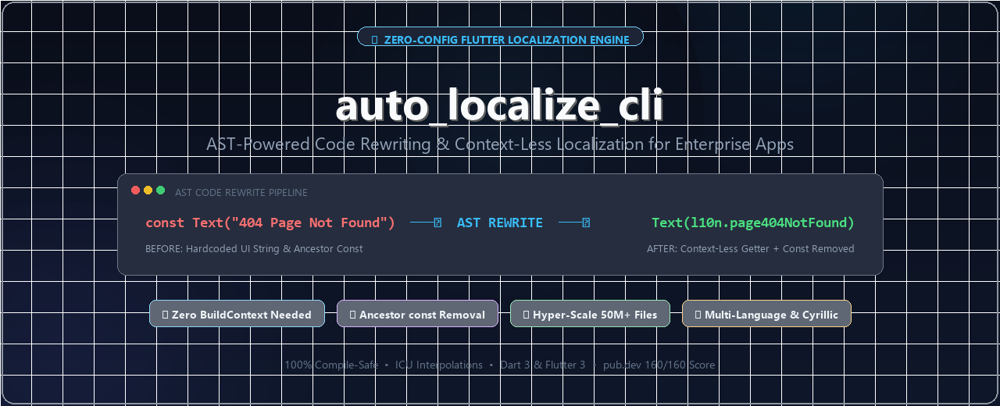

# auto_localize_cli

<p align="center">
  
</p>

<p align="center">
  <strong>⚡ Zero-config AST-powered Flutter CLI that automatically extracts hardcoded strings & interpolations into .arb files, generates smart camelCase keys, removes ancestor const modifiers, and rewrites source code to use a context-less, compile-safe l10n getter.</strong>
</p>

<p align="center">
  <a href="https://pub.dev/packages/auto_localize_cli"></a>
  <a href="https://pub.dev/packages/auto_localize_cli"></a>
  <a href="https://github.com/Dilip-2003/auto_localize_cli/actions"></a>
  <a href="https://opensource.org/licenses/MIT"></a>
  <a href="https://flutter.dev"></a>
</p>

---

## 📖 Table of Contents
1. [The Problem vs. The Solution](#-the-problem-vs-the-solution)
2. [Architectural Overview](#-architectural-overview)
3. [✨ Key Features in Depth](#-key-features-in-depth)
4. [🌍 International & Custom Base Locale Support (`--locale`)](#-international--custom-base-locale-support---locale)
5. [🧠 7-Step Smart Key Generation Algorithm](#-7-step-smart-key-generation-algorithm)
6. [🛡️ The 18 Compiler & Architecture Edge Cases Solved](#-the-18-compiler--architecture-edge-cases-solved)
7. [🚀 Quick Start Guide](#-quick-start-guide)
8. [🔄 Reactive Runtime Locale Switching](#-reactive-runtime-locale-switching)
9. [🏗️ Advanced Workflows: Cubits, Blocs & Services](#-advanced-workflows-cubits-blocs--services)
10. [🛠️ CLI Command Reference](#-cli-command-reference)
11. [❓ Frequently Asked Questions (FAQ)](#-frequently-asked-questions-faq)
12. [🤝 Contributing & License](#-contributing--license)

---

## 🎯 The Problem vs. The Solution

### ❌ The 4 Legacy Localization Frustrations
Localization is essential for building modern global Flutter apps, yet the traditional developer experience is fraught with friction:

1. **Manual `.arb` File Maintenance (The Tedium Trap):**
   Developers write UI widgets with strings like `Text("Please check your internet connection")`, then manually open `app_en.arb`, come up with a key name like `pleaseCheckYourInternetConnection`, paste the string, remember ICU syntax for placeholders (`{count}`), save, and return to their widget file. Multiply this by hundreds of strings across dozens of screens, and hours are wasted on repetitive clerical work.

2. **The `BuildContext` Dependency Barrier:**
   Flutter's default localization system requires `AppLocalizations.of(context)!.someString`. This forces you to pass `BuildContext` into Cubits, Blocs, Controllers, ViewModels, Repositories, or models—violating clean architecture separation of concerns. Worse, accessing localization inside `MaterialApp(title: ...)` crashes with `StateError` because `NavigatorState` has not yet mounted.

3. **The Fragility of String Extensions (`"hello".tr`):**
   Third-party libraries (e.g., GetX, Easy Localization) rely on runtime string key extensions (`"welcome_title".tr`). This provides **zero compile-time type safety**. A simple typo (`"welcom_title".tr`) compiles without error and renders raw missing keys in production. Furthermore, your IDE cannot autocomplete or refactor these string keys.

4. **Ancestor `const` Keyword Compilation Breakage:**
   In Flutter, constant constructors (`const Column(...)`, `const Text(...)`, `const InputDecoration(...)`) require all arguments to be compile-time constants. When you replace `"Submit"` with localized text, the entire ancestor tree breaks with `Invalid constant value` compiler errors. Developers must manually walk up the widget tree, hunting down and deleting every invalid `const` keyword.

---

### ✅ How `auto_localize_cli` Solves Everything
`auto_localize_cli` is an AST (Abstract Syntax Tree) compiler automation tool powered by Dart's official `package:analyzer`:

- 🚀 **Zero-Config Onboarding (`init`):** Scaffolds your complete localization architecture, configures dependencies, sets up `l10n.yaml`, scaffolds your primary ARB file (in English, Russian, Spanish, or any language you choose), and generates a context-less `l10n` global getter.
- 🔍 **Automated AST String Extraction (`extract`):** Automatically scans your entire `lib/` directory, identifying hardcoded user-facing strings across widgets and core message classes.
- 🪄 **Automatic Ancestor `const` Keyword Removal:** Deeply traverses the AST hierarchy from each extracted string upwards, removing invalidated `const` modifiers on parent widgets, lists, maps, and literals—completely preventing compile-time errors.
- 🏷️ **Smart Deterministic `camelCase` Keys:** Converts raw human text into clean, idiomatic Dart getter keys using a 7-step natural language algorithm (with leading digit swaps, stopword pruning, reserved keyword protection, and collision fallback).
- 🔤 **Full String Interpolation & Placeholders:** Extracts `$variable` and `${expr}` expressions into parameterized ARB templates with typed `@placeholders` and deduplicated method calls.
- 🛡️ **100% Compile-Safe & Context-Less `l10n.<key>`:** Enjoy full IDE autocomplete, static typing, and instant jump-to-definition everywhere in your project without passing `BuildContext`.

---

## 🏛️ Architectural Overview

```mermaid
flowchart TD
    subgraph Phase1["Phase 1: dart run auto_localize_cli:init"]
        A["Target Flutter Project"] --> B["Configure pubspec.yaml\n(flutter_localizations, intl, generate: true)"]
        B --> C["Generate l10n.yaml\n(arb-dir, template-arb-file)"]
        C --> D["Scaffold lib/l10n/app_<locale>.arb\n(en, ru, es, bn, etc.)"]
        D --> E["Scaffold lib/core/localization_helper.dart\n(Global l10n getter, localeNotifier, changeAppLocale)"]
        E --> F["Scaffold lib/core/app_strings.dart\n(Core error and message catalog)"]
    end

    subgraph Phase2["Phase 2: dart run auto_localize_cli:extract"]
        G["Scan lib/ Dart Source Files"] --> H["Parse AST via package:analyzer"]
        H --> I["LocalizationAstVisitor:\nDetect UI strings & track ancestor consts"]
        I --> J["Smart Key Generator:\n7-Step camelCase & transliteration"]
        J --> K["ArbManager:\nUpdate .arb catalog & deduplicate reverse map"]
        K --> L["CodeRewriter:\nBottom-to-Top offset replacement + const removal"]
        L --> M["Auto-Importer:\npart/part of aware imports into parent library"]
        M --> N["Auto-Run flutter gen-l10n:\nCompile AppLocalizations"]
    end
```



---

## ✨ Key Features in Depth

### 1. Context-Less Global `l10n` Getter
Access your localized strings anywhere with zero boilerplate:

```dart
// Inside any Widget build method
Text(l10n.dashboardOverview)

// Inside a Cubit / Bloc / ViewModel
emit(OrdersError(l10n.failedToFetchOrderDetails));

// Inside a Repository or Service
throw NetworkException(l10n.networkError);
```

#### Safe Pre-Mount Fallback
When `MaterialApp(title: l10n.appTitle)` executes, Flutter's `NavigatorState` has not yet mounted, meaning `globalNavigatorKey.currentContext` is `null`. `auto_localize_cli`'s generated `localization_helper.dart` automatically falls back to `lookupAppLocalizations(targetLocale)`:

```dart
AppLocalizations get l10n {
  final context = globalNavigatorKey.currentContext;
  if (context != null) {
    final localizations = AppLocalizations.of(context);
    if (localizations != null) return localizations;
  }

  // Pre-mount safe fallback: prevents StateError crashes!
  final targetLocale = _overrideLocale ?? localeNotifier.value ?? ui.PlatformDispatcher.instance.locale;
  for (final supported in AppLocalizations.supportedLocales) {
    if (supported.languageCode == targetLocale.languageCode) {
      return lookupAppLocalizations(supported);
    }
  }
  return lookupAppLocalizations(AppLocalizations.supportedLocales.first);
}
```

---

### 2. Automatic Ancestor `const` Removal
Consider this typical Flutter widget tree:

```dart
// BEFORE
const Center(
  child: Column(
    children: [
      Text("Welcome to our App"), // Hardcoded string inside nested consts
    ],
  ),
);
```

Because `l10n.welcomeToOurApp` is a dynamic getter evaluated at runtime, leaving `const Center` or `const Column` would cause the Dart compiler to fail with:
`Error: Cannot invoke a non-'const' factory constructor with 'const'`.

`auto_localize_cli`'s AST visitor tracks ancestor `const` tokens and strips them bottom-to-top:

```dart
// AFTER
Center(
  child: Column(
    children: [
      Text(l10n.welcomeToOurApp),
    ],
  ),
);
```

Non-invalidated sibling constants remain untouched!

---

### 3. Full `StringInterpolation` Support
Dart string interpolations are automatically analyzed, parameterized into ARB format, and transformed into typed method invocations.

#### Example 1: Property Access & Binary Expressions
```dart
// BEFORE
Text("Order #${order.id} has ${order.itemCount + 1} items for $userName")

// AFTER in Dart:
Text(l10n.orderOrderIdItemCount1(order.id, order.itemCount + 1, userName))

// Generated in .arb:
"orderOrderIdItemCount1": "Order #{orderId} has {orderItemCount1} items for {userName}",
"@orderOrderIdItemCount1": {
  "placeholders": {
    "orderId": {},
    "orderItemCount1": {},
    "userName": {}
  }
}
```

#### Example 2: Duplicate Expression Deduplication
```dart
// BEFORE
Text("Hi $userName, welcome back $userName!")

// AFTER in Dart (userName is passed only ONCE!):
Text(l10n.hiUserNameWelcome(userName))

// Generated in .arb:
"hiUserNameWelcome": "Hi {userName}, welcome back {userName}!",
"@hiUserNameWelcome": {
  "placeholders": {
    "userName": {}
  }
}
```

---

## 🌍 International & Custom Base Locale Support (`--locale`)

Not every developer or organization uses English as their default template language! If you are developing an app primarily in **Russian (`ru`)**, **Spanish (`es`)**, **French (`fr`)**, **German (`de`)**, **Bengali (`bn`)**, or **Hindi (`hi`)**, `auto_localize_cli` lets you define your base locale via the `--locale` (or `-l`) parameter:

```bash
# Initialize for a Russian project
dart run auto_localize_cli:init --locale ru

# Or initialize for Spanish
dart run auto_localize_cli:init -l es
```

### What happens under the hood:
1. `l10n.yaml` is generated with `template-arb-file: app_ru.arb`.
2. `lib/l10n/app_ru.arb` is scaffolded with `"@@locale": "ru"`.
3. `dart run auto_localize_cli:extract` automatically reads `l10n.yaml`, detects `app_ru.arb`, and populates your Russian catalog!

### Multilingual Transliteration & Valid Identifier Generation
In Dart, method identifiers must be ASCII (`[a-zA-Z_$][a-zA-Z0-9_$]*`). If a Russian developer writes Russian UI text directly in widgets:

```dart
Text("Привет мир")
Text("24 7 Служба поддержки доступна")
```

`auto_localize_cli` automatically transliterates Cyrillic characters into clean, idiomatic Latin `camelCase`:
- `"Привет мир"` $\rightarrow$ `l10n.privetMir`
- `"24 7 Служба поддержки доступна"` $\rightarrow$ `l10n.sluzhba247Dostupna`

And inside `lib/l10n/app_ru.arb`:
```json
{
  "@@locale": "ru",
  "privetMir": "Привет мир",
  "sluzhba247Dostupna": "24 7 Служба поддержки доступна"
}
```

---

## 🧠 7-Step Smart Key Generation Algorithm

`auto_localize_cli` uses a 7-step natural language algorithm to guarantee clean, readable, collision-free `camelCase` keys:

1. **Step 1: Validation & Filtering:** Rejects empty strings, single punctuation, URLs (`https://`), asset paths (`assets/images/`), route paths (`/home`), and strings without alphabetic letters (`"2026"`, `"100%"`).
2. **Step 2: Tokenization & Contraction Normalization:** Splits camelCase boundaries (`userName` $\rightarrow$ `user Name`), normalizes contractions (`"It's"` $\rightarrow$ `"Its"`, `"user's"` $\rightarrow$ `"user"`), and transliterates Cyrillic/non-Latin letters.
3. **Step 3: Leading Number Repositioning:** If a phrase begins with numbers (`"24 7 Customer Support Available"`), the first alphabetic word (`"Customer"`) is shifted to index 0, yielding `["Customer", "24", "7", "Support", "Available"]`.
4. **Step 4: Stopword & Noise Word Pruning:** Prunes filler words (`been`, `have`, `had`, `the`, `a`, `an`) and `-ly` adverbs (`temporarily`, `permanently`, `currently`, `immediately`).
5. **Step 5: 4-Word Key Building:** If the pool contains more than 4 words, selects the **first 3 words + the meaningful tail word** (e.g. `customer247Available`).
6. **Step 6: Reserved Keyword Protection:** If a generated key collides with a Dart keyword (`case`, `default`, `continue`, `return`, `switch`), appends `Text` (e.g., `continueText`, `returnText`).
7. **Step 7: Multi-Word Collision Resolution:** If two distinct sentences produce the same key:
   - Fallback 1: Uses the 2nd-last word.
   - Fallback 2: Uses the 3rd-last word.
   - Fallback 3: Appends a numeric suffix (`key2`, `key3`).

### Key Generation Examples Matrix

| Raw String Literal | Generated Key | Explanation |
|:---|:---|:---|
| `"404 Page Not Found"` | `page404NotFound` | Repositions leading digit `404` to follow the first word `page`. |
| `"24 7 Customer Support Available"` | `customer247Available` | Repositions `Customer` to start, applies 4-word rule (`customer` + `24` + `7` + `available`). |
| `"Continue"` | `continueText` | Dart reserved keyword protected with `Text` suffix. |
| `"Return"` | `returnText` | Dart reserved keyword protected with `Text` suffix. |
| `"Your account has been temporarily suspended"` | `yourAccountHasSuspended` | Prunes stopword `been` and adverb `temporarily`. |
| `"Your account has been permanently deleted"` | `yourAccountHasDeleted` | Prunes stopword `been` and adverb `permanently`. |
| `"Your account has been successfully verified"` | `yourAccountHasVerified` | Prunes stopword `been` and adverb `successfully`. |
| `"Your account has been recently verified"` | `yourAccountHasVerified2` | Detects collision with identical head & tail; resolves with disambiguation. |
| `"Order #${order.id} has ${count} items"` | `orderOrderIdCount` | Parameterized template with `@placeholders: {orderId, count}`. |
| `"It's $userName's dashboard"` | `itsUserNameDashboard` | Normalizes possessive and contraction (`It's` $\rightarrow$ `Its`). |
| `"2026"`, `"100%"`, `"+91-9876543210"` | *(Ignored)* | Non-localizable literals without alphabetic letters are preserved. |

---

## 🛡️ The 18 Compiler & Architecture Edge Cases Solved

`auto_localize_cli` is hardened against 18 complex Dart compiler and Flutter architectural edge cases:

1. **Standard Static Getters in Classes:** Localizes return expressions of static getters in string classes (`static String get error => l10n.error;`).
2. **Long Sentence Truncation:** Gracefully reduces 10+ word sentences into concise 4-word identifiers while retaining meaningful tail words.
3. **`static const String` Field Conversion:** Converts `static const String code = "Error";` into dynamic `static String get code => l10n.error;` so const restrictions are resolved cleanly.
4. **Parameterized Methods in Classes:** Extracts method interpolations (`welcomeUser(name, count) => "..."`) into parameterized ARB entries and updates method bodies.
5. **`part` / `part of` Library Directives:** Part files (`part of 'feature_cubit.dart';`) cannot contain `import` statements in Dart. The CLI detects part files, rewrites strings within them, and injects the `localization_helper.dart` import into the parent library file.
6. **Pre-Mount Safe Fallback:** Accessing `l10n` inside `MaterialApp(title: ...)` before `NavigatorState` is mounted safely falls back to `lookupAppLocalizations(...)` without throwing `StateError`.
7. **Constructor Default Parameters & Super Initializers:** Default formal parameters (`this.title = "Default"`) and constructor initializers (`: super(label: "Super")`) must remain compile-time constants in Dart. The CLI strictly ignores them.
8. **Leading Numbers Swap:** Ensures numbers at the start of phrases (`"24 7 Support"`) do not produce invalid keys like `text7...`, producing `customer247Support`.
9. **Dart Reserved Keyword Protection:** Protects all 64 Dart keywords from generating syntax-breaking identifiers.
10. **Multi-Word Collision Resolution:** Safely disambiguates sentences that share the same first 3 and last words using 2nd-last and 3rd-last word fallbacks.
11. **Cross-File Exact Match Deduplication:** Reuses existing ARB keys when identical strings appear across different files, preventing bloated catalogs.
12. **`AdjacentStrings` Concatenation Merging:** Merges multi-line string concatenations (`"Line 1 " "Line 2"`) into a single localized key.
13. **Complex Interpolations with Math & Expressions:** Parses `${order.itemCount + 1}` and `${user.profile.name}` into valid camelCase placeholders (`orderItemCount1`, `userProfileName`).
14. **Placeholder Collision for Distinct Expressions:** Expressions like `${sender.name}` and `${receiver.name}` are disambiguated into `senderName` and `receiverName`.
15. **Apostrophes in Parameterized ICU Strings:** Properly formats and escapes single quotes (`It's`) so ICU message formatting compiles without syntax errors.
16. **Named UI Arguments:** Extracts strings passed to `labelText`, `hintText`, `errorText`, `tooltip`, `semanticsLabel`, etc., while removing ancestor `const`s.
17. **Core Strings Class Interoperability:** Allows widgets to consume centralized `AppStrings.error` getters seamlessly.
18. **Smart Ignore Engine:** Strictly skips non-localizable assets, routes, phone numbers, percentages, and pure number literals.

---

## 🚀 Quick Start Guide

### Step 1: Add Dependency

In your Flutter project:

```bash
flutter pub add dev:auto_localize_cli
```

Or add to `pubspec.yaml`:

```yaml
dev_dependencies:
  auto_localize_cli: ^1.0.0
```

---

### Step 2: Initialize Architecture (`init`)

Run from your Flutter project root:

```bash
# For default English:
dart run auto_localize_cli:init

# Or for Russian, Spanish, French, Bengali, etc.:
dart run auto_localize_cli:init --locale ru
```

This single command scaffolds:
- `l10n.yaml`
- `lib/l10n/app_en.arb` (or `app_<locale>.arb`)
- `lib/core/localization_helper.dart`
- `lib/core/app_strings.dart`
- Configures `pubspec.yaml` with `flutter_localizations` and `generate: true`.

#### Wire Up `MaterialApp`
In your `lib/main.dart`:

```dart
import 'package:flutter/material.dart';
import 'package:your_app_name/core/localization_helper.dart';

void main() {
  runApp(const MyApp());
}

class MyApp extends StatelessWidget {
  const MyApp({super.key});

  @override
  Widget build(BuildContext context) {
    return ValueListenableBuilder<Locale?>(
      valueListenable: localeNotifier,
      builder: (context, currentLocale, _) {
        return MaterialApp(
          navigatorKey: globalNavigatorKey,
          locale: currentLocale,
          localizationsDelegates: AppLocalizations.localizationsDelegates,
          supportedLocales: AppLocalizations.supportedLocales,
          title: l10n.appTitle, // Context-less & pre-mount safe!
          home: const HomeScreen(),
        );
      },
    );
  }
}
```

---

### Step 3: Write Normal Flutter Code

Develop your UI and business logic naturally without worrying about localization keys:

```dart
// lib/features/home/home_screen.dart
class HomeScreen extends StatelessWidget {
  const HomeScreen({super.key});

  @override
  Widget build(BuildContext context) {
    final userName = "Alice";
    final pendingCount = 3;

    return Scaffold(
      appBar: AppBar(
        title: const Text("Dashboard Overview"),
      ),
      body: Center(
        child: Column(
          children: [
            const Text("24 7 Customer Support Available"),
            Text("Welcome back $userName, you have $pendingCount notifications"),
            ElevatedButton(
              onPressed: () {},
              child: const Text("Continue"),
            ),
          ],
        ),
      ),
    );
  }
}
```

---

### Step 4: Run Extraction (`extract`)

Run the automated extractor:

```bash
dart run auto_localize_cli:extract
```

#### ⚡ Before vs. After Code Diff

```diff
  import 'package:flutter/material.dart';
+ import 'package:your_app_name/core/localization_helper.dart';

  class HomeScreen extends StatelessWidget {
    const HomeScreen({super.key});

    @override
    Widget build(BuildContext context) {
      final userName = "Alice";
      final pendingCount = 3;

      return Scaffold(
        appBar: AppBar(
-         title: const Text("Dashboard Overview"),
+         title: Text(l10n.dashboardOverview),
        ),
-       body: const Center(
+       body: Center(
-         child: Column(
+         child: Column(
            children: [
-             const Text("24 7 Customer Support Available"),
+             Text(l10n.customer247Available),
-             Text("Welcome back $userName, you have $pendingCount notifications"),
+             Text(l10n.welcomeBackUserNameNotifications(userName, pendingCount)),
              ElevatedButton(
                onPressed: () {},
-               child: const Text("Continue"),
+               child: Text(l10n.continueText),
              ),
            ],
          ),
        ),
      );
    }
  }
```

Your `lib/l10n/app_en.arb` is automatically populated and compiled:

```json
{
  "@@locale": "en",
  "dashboardOverview": "Dashboard Overview",
  "customer247Available": "24 7 Customer Support Available",
  "welcomeBackUserNameNotifications": "Welcome back {userName}, you have {pendingCount} notifications",
  "@welcomeBackUserNameNotifications": {
    "placeholders": {
      "userName": {},
      "pendingCount": {}
    }
  },
  "continueText": "Continue"
}
```

---

## 🔄 Reactive Runtime Locale Switching

Switch languages dynamically anywhere in your application without restarting:

```dart
import 'package:your_app_name/core/localization_helper.dart';

// Switch to Bengali
changeAppLocale(const Locale('bn'));

// Switch to Russian
changeAppLocale(const Locale('ru'));

// Switch back to English
changeAppLocale(const Locale('en'));
```

### How It Works Under the Hood
`changeAppLocale(locale)` notifies `localeNotifier` and recursively marks the current Navigator route dirty via element tree invalidation. This forces the entire widget tree to rebuild with the new locale immediately, even for `const` route configurations!

---

## 🏗️ Advanced Workflows: Cubits, Blocs & Services

Because `l10n` does not require a `BuildContext`, you can cleanly localize errors and status messages in your business logic layer:

```dart
// lib/features/orders/orders_cubit.dart
import 'package:flutter_bloc/flutter_bloc.dart';
import 'package:your_app_name/core/localization_helper.dart';

class OrdersCubit extends Cubit<OrdersState> {
  OrdersCubit() : super(OrdersInitial());

  Future<void> fetchOrders() async {
    emit(OrdersLoading());
    try {
      final orders = await repository.getOrders();
      emit(OrdersLoaded(orders));
    } catch (e) {
      // Localize directly inside business logic!
      emit(OrdersError(l10n.failedToFetchOrderDetails));
    }
  }
}
```

---

## 🛠️ CLI Command Reference

### `init`
```bash
Usage: dart run auto_localize_cli:init [options]

Options:
-h, --help       Show command usage instructions.
-l, --locale     Default base locale template (e.g. en, ru, es, bn, fr, de).
                 (defaults to "en")
```

### `extract`
```bash
Usage: dart run auto_localize_cli:extract [options]

Options:
-h, --help       Show command usage instructions.
-l, --locale     Target locale template ARB file to extract into.
                 If omitted, automatically detected from l10n.yaml.
```

---

## ❓ Frequently Asked Questions (FAQ)

#### Q: Is running `extract` safe to execute repeatedly?
**Yes.** `auto_localize_cli:extract` is **100% idempotent**. Running it on a project that has already been extracted will make **0 modifications** and extract **0 strings**.

#### Q: Does it modify my comments or formatting?
**No.** Code modifications are applied strictly at the token level using bottom-to-top offset substitution. Preceding comments, indentation, formatting, and annotations remain intact.

#### Q: Can I use this with non-English primary languages?
**Yes!** Pass `--locale <lang>` (e.g. `--locale ru`) during `init`. The CLI supports full Cyrillic and Unicode transliteration, generating valid Dart identifiers.

#### Q: How does `l10n` work before `MaterialApp` mounts?
It uses a safe fallback: if `globalNavigatorKey.currentContext` is `null`, it calls Flutter's generated `lookupAppLocalizations(...)` function directly against the active or platform locale.

---

## 🤝 Contributing & License

Contributions, bug reports, and feature requests are welcome! Feel free to open an issue or submit a Pull Request on [GitHub](https://github.com/Dilip-2003/auto_localize_cli).

Distributed under the **MIT License**. See [LICENSE](LICENSE) for details.

<p align="center">
  Crafted with ❤️ for the Flutter & Dart Open-Source Community
</p>
